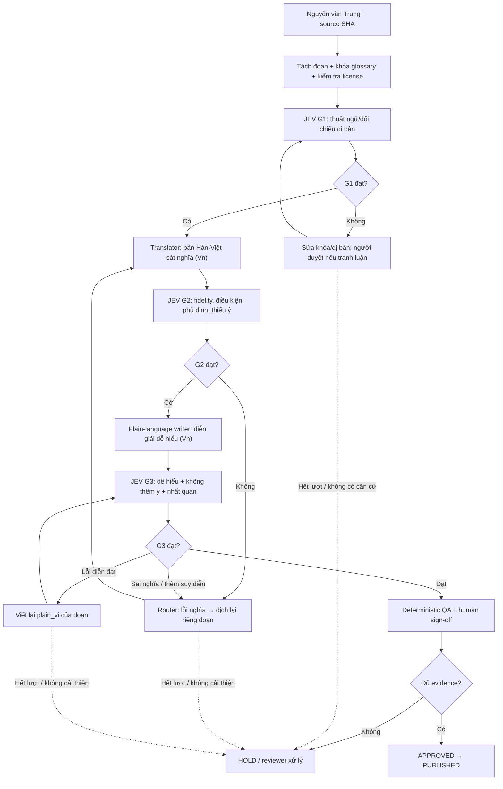

# JEV Translation Quality Loop V2 — Đề xuất 3 checkpoint có vòng sửa tự động

**Trạng thái:** DRAFT / PROPOSAL, chưa áp dụng làm release gate thật, chưa gọi Jev có phí, chưa hiệu chỉnh ngưỡng. Tài liệu bổ sung cho [TRANSLATION_WORKFLOW.md](TRANSLATION_WORKFLOW.md) và [JEV_TRANSLATION_GATE.md](JEV_TRANSLATION_GATE.md), chưa thay thế chúng đến khi review.

**Quyết định từ chủ dự án:** Không dùng Weblate; Jev-web phải kiểm định nhiều checkpoint hơn; điểm checkpoint thấp thì dịch lại đúng đoạn bị lỗi, không dịch lại toàn bộ dữ liệu.

## Sơ đồ đề xuất



**Chú ý:** G1 cần chấm theo *đợt đổi glossary*, không gọi lại nguyên bộ từ điển trên từng đoạn. Sau khi G1 PASS cho glossary version X, code vẫn kiểm tra thuật ngữ của từng đoạn; G2/G3 nhận cùng glossary version X. Nếu glossary thay đổi, các đoạn liên quan phải được invalidated và xét lại.

## Khóa đầu vào và ba sản phẩm khác nhau

- `source_zh`: nguyên văn bất biến, đầy đủ ngữ cảnh + path + commit SHA.
- `translation_hv`: dịch sát nghĩa, giữ các điều kiện/phủ định, từ chuyên ngành theo glossary.
- `plain_vi`: giải thích cho người chưa học Tử Vi; có thể giải thích **thuật ngữ** nhưng không tự thêm *phán đoán, dự đoán, chẩn đoán, quan hệ sao-cung* không xuất hiện trong nguồn.
- `locked_glossary`: mapping khóa đã duyệt, có source, aliases, trạng thái dị bản.
- `translation_revision_sha`: tính từ dữ liệu nguồn + 2 bản Việt + glossary version + prompt/model version; **mỗi lần sửa phải đánh giá lại**. Không tái sử dụng PASS của bản cũ cho revision mới.

## Checkpoint rubric

Dùng skill chính thức `typesafe-ai`; Jev-web chỉ trả `score`/`noul`/`choice` độc lập; **code quyết định** vòng lặp dựa trên kết quả. Các câu hỏi cùng trạng thái có thể bundle tối đa 8 question/lần; không coi điểm chính là phê duyệt.

| Gate | Score / Noul đề xuất | Tiêu chí thô | Luật riêng |
| --- | --- | --- | --- |
| G1 | `term_alignment` score, `term_ambiguity` noul | Khớp định danh sao/cung/cách cục, dị bản được xét | Khóa không đủ nguồn hoặc dị bản chưa duyệt => HOLD/HUMAN, không tự thỏa hiệp |
| G2 | `meaning_fidelity` score, `conditions_preserved` score, `omission_risk` noul, `contradiction_risk` noul | Đúng ý gốc, giữ phủ định/điều kiện, không thiếu hoặc đổi nghĩa | Bất kỳ dấu hiệu đảo nghĩa/phủ định hay sai sao-cung đều BLOCK |
| G3 | `plain_readability` score, `plain_consistency` score, `unsupported_additions` noul | Tự nhiên, dễ hiểu và không phát sinh luận đoán | Lỗi wording chỉ sửa `plain_vi`; lỗi ý nghĩa quay lại G2 |

### Bộ 5 mức score (0–4)

- `0`: sai hoặc không sử dụng được.
- `1`: lỗi lớn làm thay đổi ý/cản trở hiểu.
- `2`: có chỗ mơ hồ hoặc lỗi đáng kể.
- `3`: đáp ứng yêu cầu với lỗi nhỏ.
- `4`: đáp ứng rõ ràng, phù hợp đúng phạm vi.

Các câu hỏi được thiết kế độc lập cho từng khía cạnh: không gom “đúng nghĩa + dễ hiểu” vào một score.

### Ngưỡng đề xuất *chỉ để hiệu chuẩn*, KHÔNG coi là thông số đã kiểm nghiệm

Tính `p_good = P(score=3)+P(score=4)`; `p_risk` là xác suất Noul của mệnh đề có lỗi.

| Gate | Candidate pass có điều kiện | Nếu không đạt |
| --- | --- | --- |
| G1 | `p_good(term_alignment) ≥ 0.95` và `p_risk(term_ambiguity) ≤ 0.10` | Sửa alias hoặc chuyển human |
| G2 | `p_good(meaning_fidelity) ≥ 0.90`, `p_good(conditions_preserved) ≥ 0.90`, `p_risk(omission_risk) ≤ 0.10`, `p_risk(contradiction_risk) ≤ 0.10` | Rerun Translator |
| G3 | `p_good(plain_readability) ≥ 0.85`, `p_good(plain_consistency) ≥ 0.90`, `p_risk(unsupported_additions) ≤ 0.10` | Rerun Plain writer hoặc quay G2 |

Nếu nằm trong vùng không chắc chắn, giá trị bất thường hoặc thiếu dữ liệu nguồn: **REVIEW/HOLD**, không tự PASS, dù `confidence` cao. Cần thử các ngưỡng này trên bộ mẫu có nhãn người duyệt trước khi bật chốt phát hành. Không được dùng xác suất Jev để khẳng định dự đoán tử vi có giá trị khoa học.

## Loop controller — có hạn mức, chỉ sửa nơi hỏng

```text
for each source_segment:
    validate_immutability_and_license()
    require_g1_approved_glossary()
    hv = translator(source_zh, locked_glossary)
    for attempt in [1..3]:
        if deterministic_issues(hv): hv = retranslate_targeted(hv); continue
        g2 = jev_score_fidelity(source_zh, hv, glossary)
        save_evidence(g2, revision_sha)
        if g2.meets_provisional_gate: break
        if insufficient_evidence_or_stalled: HOLD
        hv = retranslate_targeted(source_zh, hv, failing_dimensions)
    if not g2_passed: HOLD

    plain = rewrite_for_general_readers(source_zh, hv, glossary)
    for attempt in [1..3]:
        g3 = jev_score_readability_integrity(source_zh, hv, plain, glossary)
        save_evidence(g3, revision_sha)
        if g3.meets_provisional_gate: break
        if g3.flags_semantic_problem: invalidate_g2_and_return_to_translation()
        if stalled_or_ambiguous: HOLD
        plain = rewrite_only_plain_vi(plain, failing_dimensions)
    if not g3_passed: HOLD
    require_deterministic_qa_and_human_signoff()
    publish_approved_revision_only()
```

- **Tối đa 3 bản thử/gate/đoạn**, đồng thời có *quota chung theo đợt* và dừng sớm khi 2 bản liên tục không cải thiện. Giới hạn này không tạo bảo đảm chất lượng: hết lượt thì **HOLD**, không hạ điểm chuẩn.
- G1 nên được giữ trên glossary từng đợt; không cần 3 cuộc gọi cho mỗi thuật ngữ khi chỉ đổi câu chữ giao diện.
- Khi Jev báo lỗi, nó **không tạo bản dịch sửa**. Router lấy những chiều đánh giá không đạt, chọn prompt sửa mục tiêu; Translator tạo bản mới; Jev chấm lại.
- Nếu Jev không chỉ ra lỗi cụ thể đủ để sửa, một agent phản biện tạo diff có trích dẫn nguyên văn để hướng dẫn Translator; diff này không thay thế judgment Jev.
- G3 thay `translation_hv` hoặc `locked_glossary` => invalidated G2/G1 liên quan, chấm lại đầy đủ các gate bị ảnh hưởng.
- Chi tiết sửa lỗi: `TERM_MISMATCH` → glossary/human; `MEANING_CHANGED` hoặc `NEGATION_INVERTED` → Translator/G2; `READABILITY_LOW` → plain writer/G3; `UNSUPPORTED_PREDICTION` → loại bỏ & recheck; `SOURCE_AMBIGUOUS` → human HOLD.

## Chi phí và thực thi qua Jev-web

- `jev_status` chỉ đọc để kiểm tra `ready`, model, mức quota; không được coi service ready là đã được phép gọi API có phí.
- `jev_evaluate` yêu cầu **user approval rõ ràng về chi phí cho đợt đó**, `charge_authorized=true`. Không có approval → HOLD, không có “đã chấm” giả.
- Mỗi request chỉ gửi *dữ liệu công khai inline <=8 KiB*, tối đa 8 câu hỏi độc lập, không gửi thông tin định danh, sinh nhật thật, API keys, path thay cho nguồn.
- Đọc `jev_status` khi chạy pilot. Lần kiểm tra lúc thiết kế báo 6 lượt/phút, 60 lượt/ngày; **không hứa đáp ứng 20 đoạn × 3 gates × nhiều retry trong một đợt**. Hết quota => HOLD, resume khi có hạn mức và được người dùng cho phép.
- 20 đoạn mẫu × G2/G3 yêu cầu **ít nhất 40 calls** chưa tính G1 và retries, nếu API không có khả năng batch nhiều state; cân nhắc chạy theo phần nhỏ và gộp nhiều câu hỏi cho cùng một đoạn trong một call.
- Dùng cache trên `source_sha + glossary_sha + translated_revision_sha + gate_version` để tránh chấm lại bản **không hề thay đổi**. Không cache PASS xuyên phiên bản glossary khác.

## Evidence phải lưu trước release

`segment_id`, `source_ref`, `source_sha`, `glossary_sha`, `hv_revision`, `plain_revision`, `gate_spec_version`, `jev_model`, `g1_g2_g3_outputs` (phân phối xác suất), `attempts`, `failure_reason`, `deterministic_check`, `human_signoff`, `final_status`, `published_commit`.

Không có evidence thật = chưa PASS. Giữ mọi phiên bản lỗi trong git/evidence để kiểm chứng regression, nhưng không lưu thông tin riêng tư.

## Chốt MVP và điều kiện chấp nhận workflow

1. Tạo 50 thuật ngữ kèm dị bản và provenance; cho G1/đồng kiểm tra.
2. Chọn 20 đoạn thử có nguyên văn công khai; ít nhất 5 đoạn cố ý sai (đảo phủ định, sai sao/cung, tự thêm dự đoán, diễn giải khó hiểu, dịch sai thuật ngữ) để xác minh Jev thực sự chặn.
3. Có nhãn đánh giá độc lập của người hiểu Tử Vi và của người đọc phổ thông. Kiểm tra tỷ lệ bỏ sót lỗi quan trọng trước khi cố định thresholds.
4. Chỉ triển khai loop controller sau pilot đã hiệu chuẩn. `main` không merge các thay đổi code hoặc bản dịch chưa qua các chốt trên.
