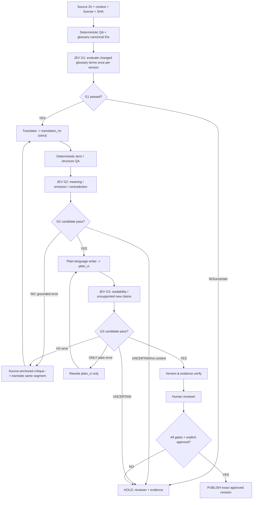

# Independent Design Review — JEV Translation Quality Loop V2
Date: 2026-11-02
Status: **PARTIAL — architecture review complete, paid Jev evaluation NOT RUN**
Review basis: [V2 proposal](JEV_LOOP_V2_PROPOSAL.md), [existing gate](JEV_TRANSLATION_GATE.md), [workflow](TRANSLATION_WORKFLOW.md), [glossary](TERMINOLOGY.md), [repo AGENTS.md](../../AGENTS.md).
Scope: **read-only source review** plus this new assessment document. No translation code, algorithms, release, merge or charged Jev evaluation in this review.

## Methods and traceability

Applied design disciplines from the source files:
- Matt Pocock [codebase-design](https://github.com/mattpocock/skills/blob/main/skills/engineering/codebase-design/SKILL.md): deep module, small interface, explicit seam and testability.
- Matt Pocock [domain-modeling](https://github.com/mattpocock/skills/blob/main/skills/engineering/domain-modeling/SKILL.md): exact glossary, distinguish ambiguous domain concepts, adversarial scenarios.
- Matt Pocock [code-review](https://github.com/mattpocock/skills/blob/main/skills/engineering/code-review/SKILL.md): separate Standards vs Spec axes; review is adapted to a **proposed design**, not an implementation diff, so no claims about running code review subagents.
- Matt Pocock [writing-for-agents](https://github.com/mattpocock/skills/blob/main/skills/productivity/writing-for-agents/SKILL.md): one source of truth, clear completion criteria, context pointers.
- TypeSafe official **installed Jev-web** skill `typesafe-ai`: atomic questions, typed Score/Noul judgments, deterministic policy, independent questions, probability distributions, representative and negative testing.
- Jev status checked read-only: `ready=true`, pinned `typesafe/jev-1.14`, charges enabled, limits 6/min, 60/day. **No actual `jev_evaluate` call was made:** charged calls require user approval and a trial budget. Do not call this a Jev score.

## Standards axis — design quality

| Finding | Severity | Evidence | Recommended correction |
| --- | --- | --- | --- |
| S1: Checkpoint invalidation too broad | HIGH | V2 `translation_revision_sha` includes `source + two translations + glossary + prompt/model`; plain-language updates unnecessarily invalidate fidelity gate. | Use stage-specific immutable fingerprints: `g1_key=glossary_sha+g1_spec+model`, `g2_key=source_sha+hv_sha+glossary_sha+g2_spec+model`, `g3_key=source_sha+hv_sha+plain_sha+glossary_sha+g3_spec+model`. |
| S2: G3 failure incorrectly branches to G2 | HIGH | Diagram maps G3 “Sai nghĩa / thêm suy diễn” directly to translator G2, though unsupported additions may originate only in `plain_vi`. | Use classified diff: `plain_vi` error => re-write plain/G3; `translation_hv` error => invalidate G2 and rerun G2+G3; glossary issue => G1 + dependents. |
| S3: Jev Score is not an error explainer | HIGH | V2 says router uses “failing_dimensions”; those scores/Nouls don't guarantee a textual explanation or exact bad span. | Deterministic checks locate known violations; an independent bilingual reviewer/critic produces a **source-anchored diff** to guide edits. If evidence ambiguous, HOLD. Jev judges the new revision. |
| S4: Thresholds too crisp for uncalibrated bilingual domain model | HIGH | G1 0.95, G2 0.90, G3 0.85, confidence = model probability only; not validated error detection. | Split smoke test (20 segments) from calibration benchmark (recommended >=60 varied cases incl deliberate negatives). Measure false negatives by severity, inter-rater differences, cost/segment; freeze thresholds only after pilot. |
| S5: Loop budget is underspecified | MEDIUM-HIGH | Max 3 attempts **per gate**, but G3 can reopen G2; overall loops may exceed forecast; proposed runtime quota 60/day. | Global `max_total_judgments_per_segment`, `max_translations_per_segment`, per-batch spend ceiling, stop on stagnation, queue/resume with immutable keys; never auto retry errors without rate-limit policy. |
| S6: G1 glossary semantics not stable | MEDIUM-HIGH | Current terms contain potential aliases/alternate schools; no canonical concept ID/source reference/approval date in table. | Glossary record: `term_id`, `source_zh`, `concept_type`, `canonical_vi`, `aliases_vi`, `school_context`, `provenance`, `review_state`, `reviewer`. G1 runs only for changed glossary entries, not every segment. |
| S7: Three sources of release policy | HIGH | `JEV_TRANSLATION_GATE.md` has p_good 0.80, V2 uses 0.85/0.90/0.95, `AGENTS.md` only points to old gate; proposal is not canonical. | Keep V2 in DRAFT; when accepted, promote **one** canonical policy file version and adjust AGENTS pointers atomically. Old thresholds become historical notes, not live competing gates. |
| S8: Review evidence needs machine-readable contract | MEDIUM | Evidence string fields not specified as valid state transitions and version dependency; unclear difference between `HOLD`, `REVIEW`, `BLOCK`. | Explicit state machine, typed `GateResult` with `status`, `version_key`, `judgment_probabilities`, `source_refs`, `classification`, `reviewer`, `evaluated_at`. Publish allowed only when all dependencies have same approved versions. |
| S9: Ambiguous additions vs necessary glossary explanation | MEDIUM | Example paraphrase adds “cần xem thêm sao/cung”; not literally in `source_zh`, but is explanatory meta-context. | Separate `translation_hv` (strict semantic) from `plain_vi` (glossary explanations allowed) and `extra_notes` (non-source comments explicitly attributed). Gate `unsupported_claim` should test **new predictions/factual assertions**, not ordinary definitions. |
| S10: Skill orchestration over-specifies methods | LOW-MEDIUM | Matt skill requires documentary pointers with explicit completion criterion; `AGENTS.md` currently points at old gate and no V2. | After choosing policy, keep `AGENTS.md` short: condition → canonical doc → PASS evidence; no duplicated thresholds. |

## Spec axis — match to user's requirements

| User requirement | Evaluation |
| --- | --- |
| Jev must check more checkpoints than a final score | **MET in proposal**: G1, G2, G3 distinct |
| If checkpoint low, **retranslate specific failing segment** | **PARTIAL**: targeted retry is described; failure routing / terminal state not fully specified |
| No Weblate, small team | **MET**: GitHub/Markdown only |
| Correct Hán–Việt and understandable Vietnamese | **PARTIAL**: separate strict + plain is good, but no validated bilingual gold set or readability usability study |
| Jev to be a mandatory release checkpoint | **MET in docs, NOT IMPLEMENTED**: service is ready but no runtime controller, CI, tests or release gating |
| Avoid expensive or infinite loops | **PARTIAL**: per-gate cap exists; global cap/budget/resume absent |
| Independent judgment / human responsibility | **MET in conceptual design**: Jev judges; release controlled by policy + human |

## Recommended V2.1 blueprint (not approved)

This is a **conceptual diagram**, not executable orchestration. Every retry arrow must pass a global attempt counter, batch budget and stalled-progress guard; if exceeded, HOLD. Routing `NO/uncertain` must not be collapsed.

## Minimal module interfaces (proposed, no code)

- `TermCatalog.resolve(term_id, school_context): TermResolution` — stable term IDs and alias traceability.
- `TranslationSegment` immutable record: `source_sha, context_sha, hv_sha?, plain_sha?, glossary_sha, source_license`.
- `TranslationJudge.evaluate(gate, immutable_snapshot): GateJudgment` — Jev adapter; `Score/Noul` per criterion and raw response; never perform mutations.
- `GatePolicy.decide(judgment, rule_evidence, budget, version_keys): GateDecision` — deterministic pure function for PASS/REWORK/HOLD/BLOCK.
- `LoopController.advance(segment_id, GateDecision): NextAction` — dependency invalidation, attempt caps, audit logging and idempotency.
- `ReleaseGate.verify(revision, evidence, human_approval): ReleaseEligibility` — fail-closed final check before publication.

Prefer **fewer public interfaces** with a deep `TranslationWorkflow` module exposing `processSegment`, `resumeSegment`, `getEvidence`; internal adapters remain private until a second integration truly needs them (Matt Pocock codebase-design).

## Test matrix for next step

- Clean Chinese term -> correct Hán–Việt -> plain explanation: should candidate-pass.
- Wrong star (紫微 to 天府): deterministic/semantic BLOCK.
- Wrong palace (财帛 to 官禄): deterministic/semantic BLOCK.
- Negation inverted: semantic BLOCK even when prose fluent.
- Omission of necessary condition: semantic REWORK.
- Adds factual fortune prediction to plain only: rewrite plain/G3, do **not** invalidate G2.
- Changes `plain_vi` without `hv` change: G2 cached, only G3 rechecked.
- Ambiguous classical syntax, mixed terminology: HOLD for domain reviewer, not blind retry.
- Rate limit / no paid authorization / 8 KiB overflow: HOLD with reason and resumable ID.
- Cross-version glossary change: only affected segment gates invalidated.
- Repeating same wrong answer for two attempts: HOLD.
- Tool errors and malformed Jev payload: HOLD; never convert to PASS.

## Release recommendation

**NO-GO for merging V2 as an enforced production gate yet. GO for a narrow pilot only** once the user approves the charged Jev test budget. Keep `main` unchanged. Use 20 public examples as smoke test, then a larger calibrated benchmark with independent reviewers. Do not assign an authentic “Jev score” before `jev_evaluate` is actually called and evidence saved.

## Paid Jev authorization still needed

User requested review with Jev-web but has not specified a paid-call cap/budget. The connector contract requires explicit approval for chargeable use. Suggested trial: **one evaluation call** on a carefully structured public summary of V2 (<=8 KiB, <=8 atomic questions); collect only aggregated judgments, not invented explanations. This single call would judge the design's apparent risks, **not** validate real translation quality. Do not run until user explicitly agrees.
