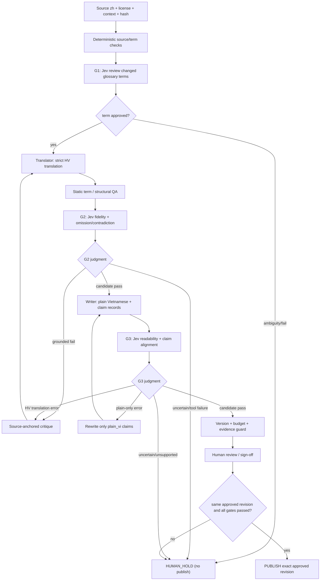

# Translation Quality Loop V2.2 — Canonical DESIGN policy

**Version:** v2.2-spec. **Status:** PUBLISHED DESIGN ONLY / NOT IMPLEMENTED / NO AUTOMATED RELEASE AUTHORIZATION.
**Scope:** dịch nguyên văn tiếng Trung về Tử Vi Đẩu Số sang Hán–Việt và lời giải thích tiếng Việt phổ thông trên `phantiendat/viet-tu-vi`. **Không** dùng Weblate, không tự ý can thiệp bộ máy lập lá số.
**Approval policy:** Tài liệu này là nguồn quy tắc duy nhất cho workflow dịch **sau khi được merge vào main**. Để phát hành nội dung dịch thật cần có implementation, dữ liệu test, Jev evidence và human sign-off; design approval không thay thế các bằng chứng đó.

## Problem statement

Bản dịch có thể trông trôi chảy nhưng sai quan hệ sao–cung, đảo phủ định, làm mất điều kiện, áp sai tên Hán–Việt giữa trường phái, hoặc tự thêm dự đoán không có nguồn. Kiểm định Jev nhiều lượt có thể tăng chất lượng nhưng cũng có thể tạo vòng lặp vô hạn, tăng chi phí, hoặc cho qua kết luận sai khi Jev chấm nhầm.

## User stories

1. Là người đọc không chuyên, tôi thấy tên sao/cung truyền thống và định nghĩa dễ hiểu, không bị diễn giải như khẳng định khoa học.
2. Là người có kiến thức Tử Vi, tôi truy được mọi kết luận về nguyên văn gốc, trường phái và bản dịch sát nghĩa.
3. Là người dịch, tôi biết **đoạn nào** và **lỗi cụ thể nào** phải sửa mà không viết lại toàn bộ.
4. Là người duyệt, tôi có thể HOLD trường hợp thiếu nguồn, dị bản, hoặc Jev chưa chắc chắn.
5. Là người quản lý, tôi có hạn mức chi phí, số lần chấm và có thể tiếp tục sau lỗi/quota mà không làm mất evidence.
6. Là người phát hành, tôi chỉ xuất bản một revision đã qua mọi gate có bằng chứng và được ký duyệt.

## Canonical domain vocabulary

- `SourceSegment`: đoạn tiếng Trung bất biến kèm ngữ cảnh, nguồn/giấy phép và source hash.
- `Term`: định danh khái niệm, không đồng nhất với chuỗi chữ Hán. Một Term có `concept_id`, `source_zh`, `category`, `school_context`, `canonical_vi`, `aliases_vi`, `provenance`, `review_state`, `approved_by`.
- `HVTranslation`: bản dịch sát nghĩa, **không** tự thêm diễn giải.
- `PlainExplanation`: bản giải thích phổ thông; có thể nói rõ nghĩa thuật ngữ nhưng không tự bổ sung kết luận lá số.
- `Claim`: mệnh đề có thể kiểm tra trong bản giải thích; bao gồm `claim_id`, `text`, `claim_type`, `source_span` hoặc `glossary_concept_id`.
- `GateJudgment`: Jev `score/noul` cùng toàn bộ phân phối và model/version/payload fingerprint. **Không** phải quyết định xuất bản.
- `GateDecision`: kết quả **thuần deterministic** do policy tính: `CANDIDATE_PASS | REWORK_HV | REWORK_PLAIN | TERM_REVIEW | HUMAN_HOLD | BLOCK`.
- `ApprovedRevision`: cùng bộ hash `source+context+glossary+hv+plain+judge_spec` và bằng chứng tất cả gate PASS + chữ ký người duyệt.
- `HOLD`: trạng thái có thể phục hồi nhưng **không** thể xuất bản. `BLOCK`: vi phạm cứng cần sửa nguồn/giấy phép/logic trước khi thử tiếp.

## Deep module interface / seam

Thiết kế **một module public** `TranslationWorkflow` với tối đa:
- `processSegment(segmentId, budgetGrant): SegmentState`
- `resumeSegment(segmentId, budgetGrant): SegmentState`
- `getEvidence(segmentId): ImmutableEvidence`

Các implementation **internal** (không cần tách thành nhiều public modules): `TermResolver`, `Translator`, `JevJudgeAdapter`, `ClaimAligner`, `GatePolicy`, `LoopController`, `ReleaseGuard`. Inject dependencies để thay Jev bằng fake adapter khi test. `GatePolicy` là pure function, nhận snapshot + typed Jev answers và trả quyết định; chỉ `LoopController` cập nhật trạng thái có transaction/idempotency; `ReleaseGuard` không thay đổi nội dung.

**Highest test seam:** `TranslationWorkflow.processSegment/resumeSegment/getEvidence` dùng stub có kết quả Jev cố định. Kiểm tra hành vi từ bên ngoài, không khẳng định đã triển khai.

## Design workflow — 3 Jev checkpoints



All retry edges above are conditional on the **global circuit breaker** below. Never loop on a hallucinated or unverifiable reason.

### G1 terminology quality

- **Once for each changed glossary item or changed glossary version**, not once per sentence. Cache by canonical `concept_id` and glossary revision. Unchanged term -> reuse approved result.
- Deterministic verify term IDs, exact aliases, scope and provenance before Jev.
- Jev judges contextual equivalence and ambiguity using source text and approved school context; unresolved variants (eg. 凤阁 / 子女宫 / 截空) -> `TERM_REVIEW` / human choice. No automatic "winner" from Jev probability.
- G1 only advances when every term actually used in the segment has approved canonical mapping.

### G2 strict semantic gate

- Input `source_zh + source_context + locked_glossary + translation_hv`, not `plain_vi`.
- Typed judgments: `fidelity` Score, `conditions_and_negation` Score, `omission_risk` Noul, `contradiction_risk` Noul.
- Known detectable mismatch in star ID, palace ID, four transformations, source conditions -> deterministic `BLOCK/REWORK_HV`.
- Jev high probability **never overrides deterministic fail**.
- Model Score/Noul **cannot locate an exact wrong span by itself**: a critic first produces a source-quoted difference; if unable to locate clear error -> HUMAN_HOLD rather than blindly retranslate.

### G3 claim-by-claim grounding and readability

- Input `source_zh + source_context + approved_hv + plain_vi + list_of_claims + glossary`.
- Each `Claim.claim_type` is one of:
  - `SOURCE_GROUNDED`: specific statement copied/paraphrased from supplied source; requires exact source span and semantic alignment.
  - `GLOSSARY_EXPLANATION`: a neutral definition of terminology; requires approved glossary concept ID, and **cannot** introduce new personal predictions.
  - `EDITOR_COMMENTARY`: clearly separated source-external explanation; not permitted in the normal automated translation view without human review, transparent attribution and separate licensing.
  - `UNSUPPORTED_PREDICTION`: forbidden in published default view.
- **Preflight deterministic** validates claim IDs, exact span exists in frozen source/context, glossary ID exists/approved, no orphaned claims; mere span existence does not establish entailment.
- **Jev** independently judges entailment and lay readability, including negation, conditions and claims with plausible-but-unsourced predictions. If a claim cannot be linked semantically -> HUMAN_HOLD.
- **Routing:** if `plain_vi` alone invented a prediction, remove/redo `plain_vi` and rerun G3, **keep G2 cached**. Only proven error inside `translation_hv` invalidates G2. Translation-only definitions allowed; fictitious forecasts are not.

### Versioning and cache invalidation

- `g1_key = H(concept_id, glossary_revision, g1_policy_version, jev_model)`
- `g2_key = H(source_sha, context_sha, hv_sha, used_term_revision_hash, g2_policy_version, jev_model)`
- `g3_key = H(source_sha, context_sha, hv_sha, plain_sha, claim_records_sha, used_term_revision_hash, g3_policy_version, jev_model)`
- `publish_key = H(g1_key_set, g2_key, g3_key, human_approval_revision)`.
- Updating only `plain_vi` -> invalid G3 and publish approval, **not** G2.
- Updating `hv` -> invalid G2, G3 and publish approval.
- Updating one `Term` -> invalid G1 of that term and G2/G3 on dependent segments only.
- Changing source/context, policy spec or model -> invalidate dependent gates. Every mutation makes the old release approval stale.

## Deterministic circuit breaker — enforce BEFORE paid Jev calls

**Pilot budgets (provisional defaults; should be configurable and signed off per batch):**
- `max_hv_revisions_per_segment = 3`; `max_plain_revisions_per_segment = 3`.
- **Không còn hard-cap của Jev-web**: read-only `jev_status` ngày 2026-11-02 xác nhận `rate_limiting_enabled=false`, `requests_per_minute=null`, `requests_per_utc_day=null`. Số 6/phút và 60/ngày trong các review cũ chỉ là lịch sử.
- `max_paid_jev_calls_per_segment` là **ngân sách do ứng dụng/người dùng phê duyệt theo đợt**, không phải trần cố định của nhà cung cấp. Đề xuất mặc định cho pilot 7 lượt G2/G3 mỗi đoạn; có thể tăng có kiểm soát bằng grant mới và bộ kiểm thử. G1 mặc định một lượt mỗi thuật ngữ thay đổi, ngoại lệ cần approval.
- Lượt gọi quá grant vẫn `HUMAN_HOLD`, dù upstream không giới hạn tốc độ.
- `max_jev_calls_per_batch = min(user_authorized_cap, live service capacity)`; `max_cost_usd_per_batch` user-configured, **default 0** until explicit approval.
- `max_repeated_same_fingerprint = 1`; exact same revision is read from cache, never charged again.
- Stagnation: two attempts with no substantive edit/clear error correction -> HUMAN_HOLD. Error/429/quota/network/invalid Jev schema -> pause with resumable `HOLD`, **do not retry with charge_authorized unless consent/budget remains valid**.
- All counters persisted per segment and per batch with idempotency keys. `JevJudgeAdapter` has request fingerprint; worker locks/transaction prevent duplicate charges on concurrent resumes.
- **Không suy diễn không có rate limiter = không thể gặp 429**: OpenRouter, TypeSafe, mạng, tài khoản hoặc hạ tầng vẫn có thể trả 429/503. Dùng `Retry-After` nếu có, pause/resume bằng grant còn hiệu lực, không tự lặp vô hạn; kiểm tra `jev_status` thực tế.
- Không hardcode hạn mức bên ngoài, nhưng vẫn thực thi an toàn chi phí, số revision, duplicate suppression, timeout và human sign-off.


## Expanded error gate — nguồn lỗi quyết định tuyến xử lý

Để tránh quy mọi lỗi thành một `HOLD` không giải thích được, hệ thống tách **loại lỗi** và **trạng thái tiếp tục**, trong khi giữ nguyên nguyên tắc fail-closed. Bảng dưới đây là chính sách triển khai; prototype T01 mới hiện thực hóa **một phần**.

| Nhóm lỗi | Ví dụ | Trạng thái | Hành động có căn cứ |
| --- | --- | --- | --- |
| `SOURCE_INTEGRITY` | Hash nguồn sai, nội dung không có quyền dùng, định danh sao/cung gốc bị sửa | **BLOCKED** | Dừng trước Jev; người quản lý nguồn xác minh và nhập lại nguồn bất biến |
| `INPUT_REPAIRABLE` | Plain text rỗng, danh sách claim thiếu reference, alias chưa khớp | **REWORK_REQUIRED** | Trả về công đoạn sinh dữ liệu/từ điển, sửa bản mới; không gửi payload hỏng cho Jev |
| `G2_MEANING_ERROR` | Dịch đảo phủ định/đổi sao có chứng cứ trích nguyên văn | **REWORK_HV** | Sửa riêng HV; mất hiệu lực G2/G3 của đoạn |
| `G3_EXTRA_CLAIM` | Plain thêm dự đoán không có trong source | **REWORK_PLAIN** | Sửa riêng plain; giữ G2 theo hash |
| `PROVIDER_TRANSIENT` | Upstream 429/502/503, timeout, lỗi kết nối | **RETRYABLE_HOLD** | Ghi mã lỗi và Retry-After nếu có; caller **chủ động** resume, có grant; không tự động gọi vô hạn |
| `JEV_RESPONSE_SCHEMA` | Thiếu scores/nouls, phân phối sai độ dài, sai dữ liệu | **RETRYABLE_HOLD** một lần | Giữ response/evidence, cho một lượt thử lại có approval; lặp lại thì **HUMAN_HOLD** để sửa adapter/schema |
| `AUTH_CONFIGURATION` | 401/403, API key hỏng, cấu hình model sai | **HUMAN_HOLD** | Sửa cấu hình/quyền trước khi tiếp tục; không dùng retry tuyến tính |
| `SEMANTIC_AMBIGUITY` | Nguồn Hán không rõ, khác biệt trường phái, claim không chứng minh được | **HUMAN_HOLD** | Gửi đoạn + nguồn + dị bản cho người duyệt; không tự nâng điểm |
| `APPLICATION_BUDGET` | Hết grant chi phí / số lượt tối đa của **đợt** | **HUMAN_HOLD** | Báo chi phí và kết quả đã có; chỉ tiếp tục nếu cấp grant mới |
| `STALE_APPROVAL` | Plain/glossary sửa sau khi duyệt | **HUMAN_HOLD** | Invalidate các checkpoint phụ thuộc, đánh giá bản revision mới |

**Lưu ý:** phân loại một lỗi dữ liệu *không có nghĩa* được phép làm sạch tự động mọi lỗi: sai nguồn hoặc sai phép dùng vẫn là `BLOCKED`. `HUMAN_HOLD`, `RETRYABLE_HOLD` và `REWORK_REQUIRED` đều **không thể xuất bản**. Không chuyển Jev network failure thành `PASS`; không coi `429` là hết quota của Jev-web nếu chưa có bằng chứng nguồn lỗi. Gắn source/error code/attempt/grant vào evidence.

### Graceful degradation và resume

1. Giữ nguyên `source_sha, glossary_sha, hv_sha, plain_sha, gate_spec_sha, request_fingerprint` mỗi lần tạm dừng.
2. Khi provider có `retryAfterMs`, ưu tiên thời gian đó; khi không có, dùng chính sách backoff có giới hạn ở *scheduler* tương lai. T01 **không có** scheduler hoặc background retry.
3. Chỉ resume trên cùng revision khi đã xử lý điều kiện lỗi, grant còn hợp lệ và budget chưa hết; khi thông số thay đổi phải chấm lại các gate phụ thuộc.
4. Audit trả về `last_valid_gate, failure_category, next_action, attempts_spent, authorization_scope`.
5. Tối thiểu một vòng kiểm thử bằng fake JudgeAdapter cho mỗi loại lỗi; kiểm thử thực tế bằng Jev chỉ sau khi user cấp phép chi phí rõ ràng.

## GateDecision truth table (fail-closed)

| Condition | Deterministic outcome |
| --- | --- |
| No rights to use source, incomplete source span, unknown term ID, corrupted data, changed engine JSON | `BLOCK` |
| No paid permission, no quota, budget exceeded, Jev tool error, incomplete schema, missing reviewer, unsupported or uncertain claim | `HUMAN_HOLD` |
| G1 glossary ambiguous | `TERM_REVIEW` → human; no auto-threshold substitution |
| G2 source-grounded semantic error | `REWORK_HV` if global budget permits, otherwise `HUMAN_HOLD` |
| G3 plain-only readability or unsupported addition | `REWORK_PLAIN` if allowed, otherwise `HUMAN_HOLD` |
| G3 proves `HVTranslation` wrong | Invalidate G2/G3 → `REWORK_HV` within global budget |
| All gate judgments satisfy **CALIBRATED** policy and all deterministic checks pass | `CANDIDATE_PASS`, require explicit human sign-off |
| All conditions pass + exact revision and sign-off match | `PUBLISHED`; no other path emits this state |

**Threshold rules:** V2.1's 0.95/0.90/0.85 probabilities are **not yet calibrated**. During pilot, use them only as candidate triage bands; **no fully automated PASS** until observed critical-miss metrics and human concordance justify thresholds. `confidence` on Score is not the decision criterion. Never interpret Jev confidence/likelihood as empirical accuracy.

## Evidence contract and release requirements

Typed record per attempt:
```text
source_segment_id, source_path, source_sha, source_context_sha, source_license
term_ids_used, glossary_revision, hv_sha, plain_sha, claim_records_sha
gate_name, gate_policy_version, jev_model, request_hash, Jev raw typed distributions
decision, triggering_rule, source_quote_or_glossary_ref, error_category
batch_id, charge_approval_ref, attempt_no, cumulative_paid_calls, cost_so_far
evaluated_at, human_reviewer, approved_revision, release_commit
```

- No evidence -> HOLD. Wrong hash/version -> HOLD. Model unavailable or unreachable -> HOLD. User no permission for charges -> HOLD.
- Published release refers exactly to frozen approved content; any change after approval invalidates publication eligibility.
- Retain per-revision error evidence for regression without storing private birth data.

## Independent verification plan (smoke → benchmark → release)

**Smoke (20 segments):** at least 5 intentionally malformed samples, plus unambiguous correct controls and glossary disputes. Must exercise gates, reroute, HOLD, stale hashes, and budget exhaustion. A success here means the pipeline operates, **not** that Jev is a valid domain judge.

**Validation before automation (recommend ≥60 diverse holdout cases, not a magic statistical guarantee):**
- Independent bilingual/domain reviewer assigns gold labels for `fidelity`, `term_alignment`, `unsupported_additions`; separate lay readers label `plain_readability`.
- Include adversarial mutations: negation inversion, switched star/palace, changed `化禄/化忌`, missing caveat, fabricated health/wealth/harm prediction, ambiguous classical Chinese, mixed school variants.
- Report `critical_false_negative_count / critical_error_cases`, count of true severe errors that gate incorrectly marked `CANDIDATE_PASS`, reviewer disagreements, precision/recall by category, cost per segment, p50/p95 judgments/cost, rate-limit behavior and human HOLD load.
- Require **zero missed critical errors on the initial pilot** as a practical provisional stop rule, **not** as proof of zero population error. Any missed critical error -> block release, fix gate/policy and rerun an untouched holdout.
- Stress tests: 429/API malformed payload, worker retry after crash, concurrent resume, stale release approval, updated glossary/version, text over 8 KiB.
- Run `npm ci`, `npm run typecheck`, `npm test`, `npm run build` for implementation PR. Current document-only PR does not imply these tests have run.

## Release/readiness states

- **SPEC_PUBLISHED** — this document merged/published; no translation agent running.
- **PILOT_APPROVED** — reviewer and user approve bounded paid test budget; only public synthetic data.
- **GATE_VALIDATED** — pilot/benchmark evidence, versioned thresholds, no open critical problems.
- **IMPLEMENTED_NOT_RELEASED** — code completed and CI checked; no content published.
- **TRANSLATION_PUBLISHED** — actual approved translation revision has passed all conditions.

No naming shortcut between these states. In particular, publishing **this document** is not shipping a working feature.

## Out of scope

No automatic astrological prediction, editing Chinese chart engine, replacing lunar calculation or changing school rules, commercializing copyrighted teaching quotes, bulk copying a full dataset, or adopting Weblate.

## Source review and decisions

- Matt Pocock: [codebase-design](https://github.com/mattpocock/skills/blob/main/skills/engineering/codebase-design/SKILL.md), [domain-modeling](https://github.com/mattpocock/skills/blob/main/skills/engineering/domain-modeling/SKILL.md), [writing-for-agents](https://github.com/mattpocock/skills/blob/main/skills/productivity/writing-for-agents/SKILL.md), [to-spec](https://github.com/mattpocock/skills/blob/main/skills/engineering/to-spec/SKILL.md), [tdd](https://github.com/mattpocock/skills/blob/main/skills/engineering/tdd/SKILL.md). Applied as principles against public GitHub skill sources, **not** executed via Matt Pocock native subagent harness.
- TypeSafe official installed `typesafe-ai` skill: atomic Score/Noul judgment separate from deterministic release policy; test positive/negative labeled cases.
- Prior evidence: [Matt review V2](REVIEWS/JEV_LOOP_V2_MATT_POCOCK_REVIEW_2026-11-02.md) and [actual Jev score for V2.1](REVIEWS/JEV_LOOP_V21_JEV_WEB_SCORE_2026-11-02.md): prior design score **7.84/10** (arithmetic of 7 scores); lowest axes were budget and empirical validation. `noul=0.81` was judgment that an unsourced prediction might escape, **not** observed failure frequency.
